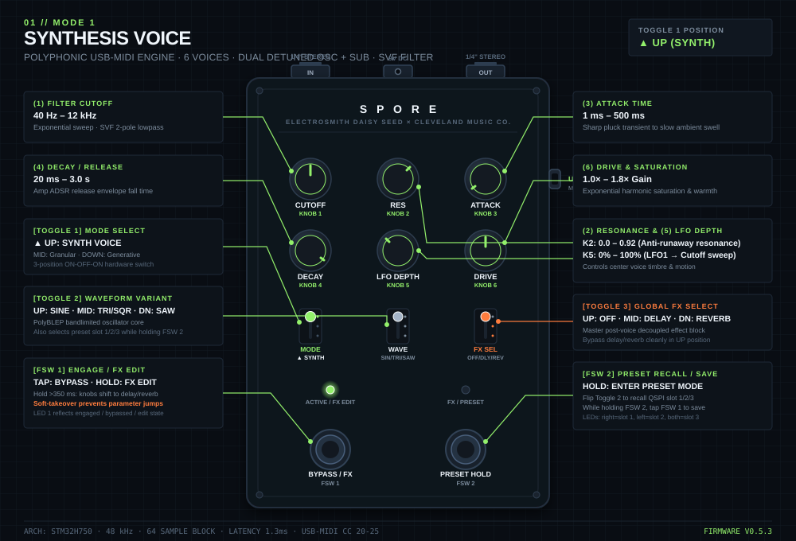
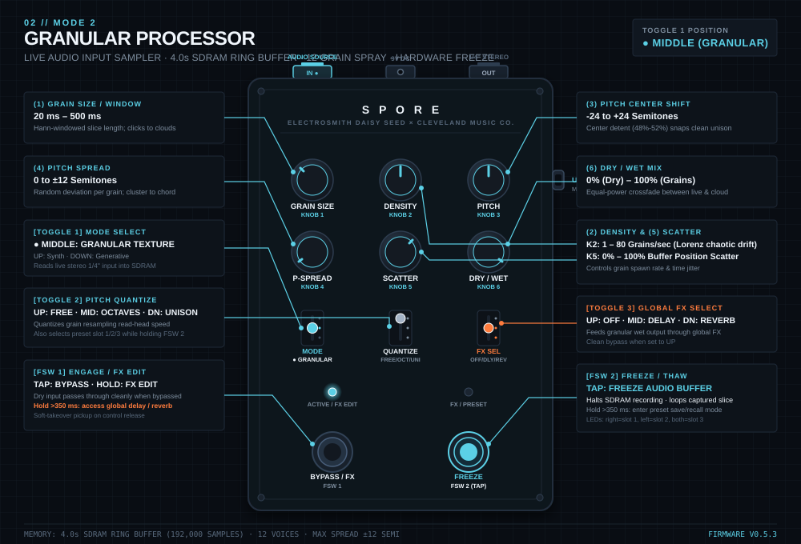
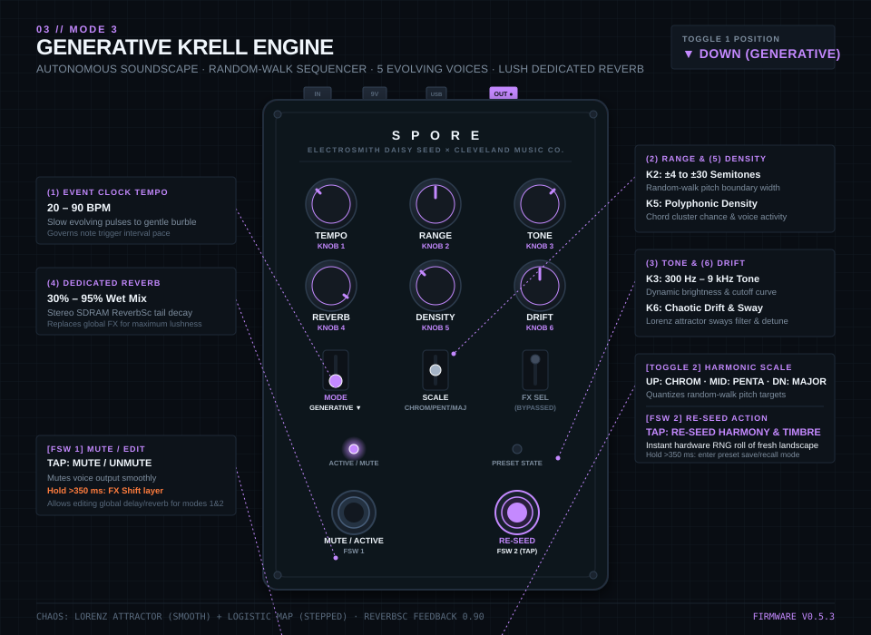

# 4.0 modes and controls

The Spore platform is organized into three distinct operational modes, selectable instantly via **[Toggle 1]**. Each mode transforms the physical control surface (six potentiometers, per-mode variant switch, and footswitches) into a dedicated instrument.

```
[Toggle 1] positions:
▲ UP       Mode 1: Synth       (playable polyphonic voice over USB-MIDI)
● MIDDLE   Mode 2: Granular    (live audio input texture sampler + freeze)
▼ DOWN     Mode 3: Generative  (autonomous self-playing Krell ambient engine)
```

---

## 4.1 Mode 1: Synth

A 6-voice polyphonic synthesis engine played over **USB-MIDI**. Each voice features dual detuned anti-aliased PolyBLEP oscillators plus a sub-oscillator, feeding into an exponential state-variable filter (SVF), overdrive stage, and dual envelopes.



### Controls

| Control | Parameter | Range / Function | Notes |
| :--- | :--- | :--- | :--- |
| **(Knob 1)** | **Cutoff** | `40 Hz – 12 kHz` | Exponential sweep; SVF 2-pole lowpass filter |
| **(Knob 2)** | **Resonance** | `0.0 – 0.92` | Filter peak sharpness; clamped below self-osc runaway |
| **(Knob 3)** | **Attack** | `1 ms – 500 ms` | Amp & filter envelope rise time (fast pluck to slow pad) |
| **(Knob 4)** | **Decay / Release** | `20 ms – 3.0 s` | Envelope fall time (sustain level set via Propagator) |
| **(Knob 5)** | **LFO Depth** | `0% – 100%` | Master depth routing global LFO 1 into filter cutoff |
| **(Knob 6)** | **Drive** | `1.0× – 1.8×` | Exponential saturation and warm harmonic distortion |
| **[Toggle 2]** | **Waveform** | `UP: Sine` · `MID: Tri/Sqr` · `DOWN: Saw` | Anti-aliased PolyBLEP core |
| **[Toggle 3]** | **Global FX** | `UP: Off` · `MID: Delay` · `DOWN: Reverb` | Post-voice master stereo effects block |
| **[FSW 1]** | **Engage / Edit** | `Tap`: bypass voice · `Hold`: edit FX layer | Hold > 350 ms for soft-takeover FX parameter edit |
| **[FSW 2]** | **Preset Latch** | `Hold`: enter preset select mode | Flip **[Toggle 2]** to recall slot 1, 2, or 3 |

> [!TIP]
> **Pro-tip:** Hold **[FSW 1]** to temporarily remap knobs 1–6 to the global delay and reverb parameters. Spore uses **soft-takeover** pickup sensing, so parameter values will not jump when returning to voice mode.

---

## 4.2 Mode 2: Granular

A real-time granular cloud processor. Spore continuously records incoming stereo/mono audio from the Hothouse 1/4" input into an SDRAM ring buffer (4.0 seconds / 192,000 samples) and sprays up to 12 overlapping, Hann-windowed grains with independent pitch and positional jitter.



### Controls

| Control | Parameter | Range / Function | Notes |
| :--- | :--- | :--- | :--- |
| **(Knob 1)** | **Grain Size** | `20 ms – 500 ms` | Grain slice length; micro-clicks to lush sustained cloud |
| **(Knob 2)** | **Density** | `1 – 80 grains / sec` | Spawn rate; modulated with organic Lorenz chaos drift |
| **(Knob 3)** | **Pitch** | `-24 to +24 semitones` | Center pitch; 48%–52% center band snaps cleanly to unison |
| **(Knob 4)** | **Pitch Spread** | `0 to ±12 semitones` | Random pitch deviation per grain (widens cloud into chords) |
| **(Knob 5)** | **Scatter** | `0% – 100% buffer` | Grain start time randomization within the 4s buffer |
| **(Knob 6)** | **Dry / Wet** | `0% (dry) – 100% (grains)` | Equal-power crossfade between live input and granular cloud |
| **[Toggle 2]** | **Pitch Quantize** | `UP: Free` · `MID: Octaves` · `DOWN: Unison` | Restricts pitch spread and pitch knob shifts |
| **[Toggle 3]** | **Global FX** | `UP: Off` · `MID: Delay` · `DOWN: Reverb` | Routes wet granular spray through global delay/reverb |
| **[FSW 1]** | **Engage / Edit** | `Tap`: bypass FX · `Hold`: edit FX layer | Dry input passes through cleanly when bypassed |
| **[FSW 2]** | **Freeze** | `Tap`: freeze / thaw audio buffer | Stops recording into SDRAM; loops captured slice indefinitely |

> [!TIP]
> **Pro-tip:** Tap **[FSW 2]** to engage **Freeze** immediately after playing a note or phrase into the input. Once frozen, adjust **(Knob 1)** (size), **(Knob 4)** (spread), and **(Knob 5)** (scatter) to sculpt an infinite atmospheric drone from the frozen moment.

---

## 4.3 Mode 3: Generative

An autonomous, self-playing ambient voice inspired by the Don Buchla "Krell" patch. An internal stochastic clock drives a bounded random-walk sequencer across up to 5 evolving voices. Features automatic timbre-morphing and runs through a dedicated, lush SDRAM stereo reverb.



### Controls

| Control | Parameter | Range / Function | Notes |
| :--- | :--- | :--- | :--- |
| **(Knob 1)** | **Tempo** | `20 – 90 BPM` | Slow stochastic clock trigger interval |
| **(Knob 2)** | **Pitch Range** | `±4 to ±30 semitones` | Bounds of the random-walk interval around note 52 (E3) |
| **(Knob 3)** | **Tone** | `300 Hz – 9 kHz` | Filter brightness curve; sways with internal Lorenz attractor |
| **(Knob 4)** | **Dedicated Reverb** | `30% – 95% wet` | Tail length & wet level of built-in stereo ReverbSc |
| **(Knob 5)** | **Density** | `0.0 – 1.0` | Polyphonic chord probability and event burst activity |
| **(Knob 6)** | **Drift** | `0.0 – 1.0` | Detune spread, analog pitch instability, and filter sway |
| **[Toggle 2]** | **Scale** | `UP: Chromatic` · `MID: Minor Pentatonic` · `DOWN: Major` | Quantizes random-walk pitch targets |
| **[Toggle 3]** | **FX Select** | *(Bypassed)* | Generative mode utilizes its own dedicated reverb on Knob 4 |
| **[FSW 1]** | **Mute / Edit** | `Tap`: mute audio · `Hold`: edit global FX | Smooth output silence without killing internal state |
| **[FSW 2]** | **Re-seed** | `Tap`: roll new timbre & walk | Rolls fresh patch from hardware RNG and resets walker |

> [!TIP]
> **Pro-tip:** Tap **[FSW 2]** anytime you want a completely fresh sonic landscape. Spore samples the STM32 true hardware random number generator (RNG) to re-seed the random walk path, roll initial oscillator timbres, and reset envelopes.

---

## 4.4 Global FX Layer (Knob Shift)

When in **Mode 1 (Synth)** or **Mode 2 (Granular)**, holding **[FSW 1]** for more than 350 ms enters the **FX Edit Layer**. **[LED 1]** dims to 50% brightness to confirm edit mode.

While holding **[FSW 1]**, the six knobs are temporarily remapped to:

```
┌──────────────────┬──────────────────┬──────────────────┐
│  (Knob 1)        │  (Knob 2)        │  (Knob 3)        │
│  FX Mix          │  Delay Time      │  Delay Feedback  │
│  0% – 100%       │  20 ms – 1.5 s   │  0% – 85%        │
├──────────────────┼──────────────────┼──────────────────┤
│  (Knob 4)        │  (Knob 5)        │  (Knob 6)        │
│  Delay Tone      │  Reverb Decay    │  Reverb Damp     │
│  600 Hz – 12 kHz │  Tail (60–98%)   │  HF (800–18 kHz) │
└──────────────────┴──────────────────┴──────────────────┘
```

Release **[FSW 1]** to return to mode macro controls. Knobs will not jump thanks to built-in soft-takeover pickup detection.

---

## 4.5 Presets & Combos

Three non-volatile presets per mode are stored in onboard QSPI flash memory. The active preset slot directly mirrors the physical three-position **[Toggle 2]** switch.

### Recalling a Preset
1. Hold **[FSW 2]** (> 350 ms) to enter preset recall mode.
2. The LEDs blink to indicate the active preset:
   - **[LED 2]** (right) blinking = Slot 1 (`[Toggle 2]` UP)
   - **[LED 1]** (left) blinking = Slot 2 (`[Toggle 2]` MIDDLE)
   - **Both LEDs** blinking = Slot 3 (`[Toggle 2]` DOWN)
3. Flip **[Toggle 2]** to the desired slot (UP, MID, DOWN) to instantly load the preset sound.
4. Release **[FSW 2]**.

### Saving a Preset
1. Hold **[FSW 2]**.
2. Flip **[Toggle 2]** to the target slot (1, 2, or 3).
3. While still holding **[FSW 2]**, tap **[FSW 1]**.
4. Both LEDs will flash rapidly (60 ms strobe for 500 ms) to confirm the preset is burned to QSPI flash.
5. Release **[FSW 2]**.

